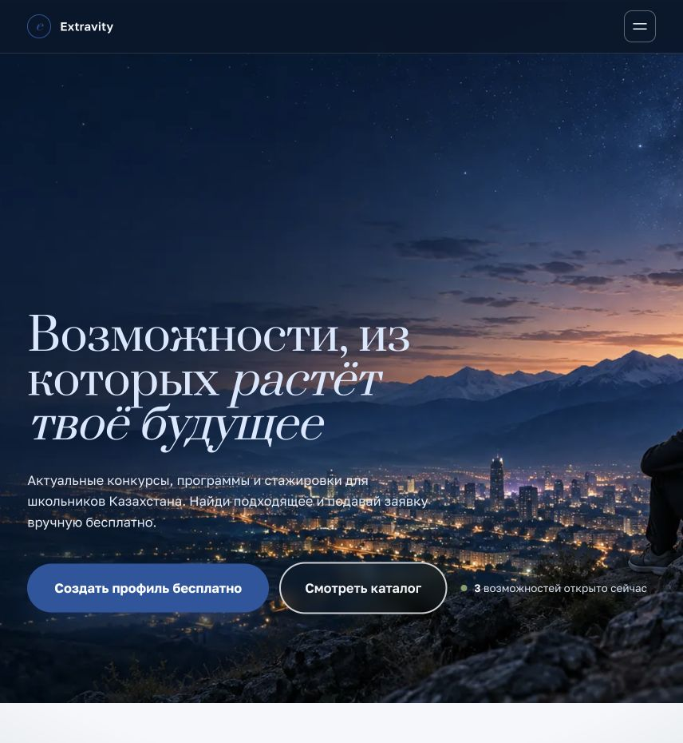
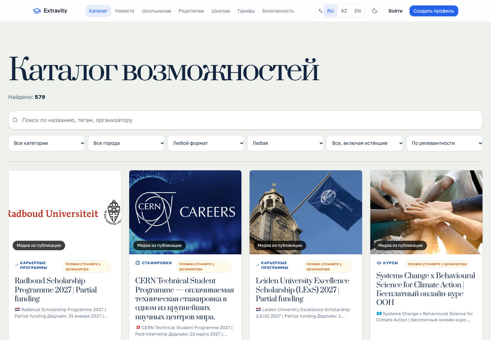
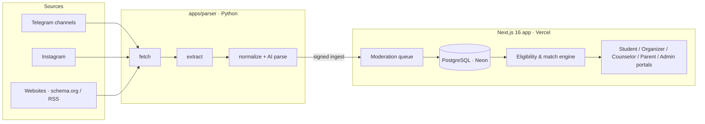

<div align="center">

# 🎓 Extravity

### The operating system for extracurricular opportunities — built for students in Kazakhstan

Discover olympiads, scholarships, internships and summer programs, get matched to the ones you're actually eligible for, never miss a deadline, and build a portfolio of achievements over time.

[](https://extracurriculars-kz.vercel.app)


-4169E1?style=flat-square&logo=postgresql&logoColor=white)


**🇬🇧 English** · [🇷🇺 Русский](README.ru.md)

</div>

---

<p align="center">
  
  
</p>

## The problem

Opportunities for high-school students in Kazakhstan — olympiads, scholarships, exchange and summer programs, internships — are scattered across Telegram channels, Instagram posts and university websites. Students miss deadlines, apply to programs they aren't eligible for, and lose track of what they've already achieved.

**Extravity puts all of it in one place** and turns it into a personal pipeline: *find → check eligibility → plan → apply → keep the result in your portfolio.*

## ✨ What it does

| | Feature | |
|---|---|---|
| 🔎 | **Opportunity catalog** | Public, searchable, filterable by category, city, format and price — **579 live opportunities** on the demo |
| 🎯 | **Eligibility + match score** | Hard filters (age, grade, city, language, budget) plus a soft match score *with explanations of why* |
| 🛡️ | **Trust score** | Rates how reliable an opportunity is and flags suspicious ones |
| 📰 | **Personal feed** | "Recommended", "Deadline soon", "Free", "In your city"… |
| 📅 | **Deadline calendar** | Saved items, notifications, ICS export |
| 🗂️ | **Application workspace** | Statuses, checklist, notes, and a one-click *Application Pack* of profile data |
| 🏆 | **Portfolio & documents** | Long-term record of achievements, PDF export |
| 🌐 | **ru / kk / en** | Type-safe dictionaries, locale-aware dates and currency |

### Five portals, one platform

- **Student** — onboarding wizard (interests, skills, goals, constraints), feed, applications, portfolio
- **Organizer** (`/organizer`) — publish opportunities through moderation, see views/saves/conversion, request verification
- **Counselor** (`/counselor`) — invite students, view a profile **only after the student consents** (revocable in one click)
- **Parent** (`/parent`) — children's deadlines and planned costs, grant/revoke consent instantly
- **Admin** — moderation queue, CRUD, organizer verification, sources, users, full audit log

## 🏗️ Architecture



- **Ingestion never auto-publishes.** The parser pushes into a moderation queue over a signed endpoint. Cards with unconfirmed country, format or cost are blocked from publishing until the source confirms them.
- **Built with minors' data in mind.** Counselors and parents only see what the student has explicitly consented to share, and every privileged action goes to the audit log.
- **Honest integrations.** Storage, email, Telegram bot, Sentry, PostHog and payments are written and wired up. Without keys, each one runs as an explicit mock that is labeled in the UI.

## 🧱 Tech stack

| Layer | Tech |
|---|---|
| Web app | Next.js 16 (App Router, Server Actions), React 19, TypeScript (strict) |
| UI | Tailwind CSS v4, custom component library, lucide-react, dark mode, mobile-first |
| Data | Prisma 6 + PostgreSQL (Neon serverless in production) |
| Auth | Email + password (bcrypt), JWT sessions in httpOnly cookies (`jose`), RBAC with 7 roles |
| Validation | Zod |
| Parser | Python: Telethon (Telegram MTProto), Instagram and web collectors, LLM-assisted extraction |
| Quality | Vitest unit tests, Playwright E2E, GitHub Actions CI |
| SEO | Metadata, Open Graph, schema.org `Event`, sitemap, localized slugs |

## 🚀 Try it

Open the **[live demo](https://extracurriculars-kz.vercel.app)** and sign in with any demo role (password `password123`):

`student@demo.kz` · `organizer@demo.kz` · `counselor@demo.kz` · `parent@demo.kz` · `admin@demo.kz`

## 🛠️ Run locally

```bash
npm install
cp .env.example .env          # set DATABASE_URL and AUTH_SECRET (openssl rand -hex 32)
npx prisma migrate deploy
npm run db:seed
npm run dev                   # http://localhost:3000
```

```bash
npm test                      # unit tests (Vitest)
npx playwright test           # end-to-end tests
```

Parser:

```bash
cd apps/parser && python3 -m venv .venv && source .venv/bin/activate
pip install -r requirements.txt
APP_URL=<app-url> PARSER_INGEST_SECRET=<secret> python run.py --dry-run
```

## 📚 Docs

[Architecture](docs/architecture.md) · [Database](docs/database.md) · [Permissions](docs/permissions.md) · [Security & minors' data](docs/security.md) · [Parser](docs/parser.md) · [Telegram ingestion](docs/telegram-ingestion.md) · [Deployment](docs/deployment.md) · [Product decisions](docs/product-decisions.md)

## 📄 License

[MIT](LICENSE) © 2026 Alan Bai
